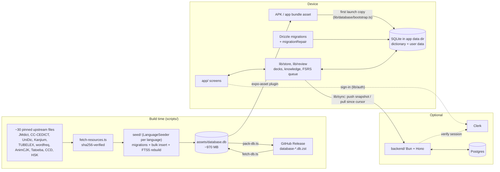

# Architecture

Remlang is an Expo (SDK 55, React Native 0.83) app with no required server. The dictionary and all user data live in a single SQLite database on the device. An optional sync API copies user data to Postgres.

## Module map

| Path | What lives there |
|---|---|
| [`app/`](app/) | expo-router screens. [`_layout.tsx`](app/_layout.tsx) prepares the database (copy, migrate, repair), then mounts the drawer, providers and `AutoSyncManager`. The main screens are `dictionary`, `character`, `decks`, `deck/[id]`, `knowledge/[id]`, `statistics` and `settings`. |
| [`lib/database/`](lib/database/) | Drizzle [`schema.ts`](lib/database/schema.ts) (dictionary tables plus user tables), [`lexicon.ts`](lib/database/lexicon.ts) (search and entry detail queries, ranking), [`searchIndex.ts`](lib/database/searchIndex.ts) (FTS5 `entry_search`), [`bootstrap.ts`](lib/database/bootstrap.ts) (first-launch copy) and [`migrationRepair.ts`](lib/database/migrationRepair.ts). |
| [`lib/store/`](lib/store/) | Data access the screens call. [`decks/`](lib/store/decks/) holds deck and folder CRUD, linked decks, trash, and the Legend-State snapshot `decks$`. Alongside it are `deckReviewStore`, `knowledgeStore`, `dictionarySearchStore` and `appLanguageStore`. |
| [`lib/review/`](lib/review/) | [`fsrs.ts`](lib/review/fsrs.ts) builds sessions, takes ratings, handles undo and computes due counts. `reviewLimits`, and `pitchEligibility` and `strokeEligibility` decide which review types a card supports. |
| [`lib/sync/`](lib/sync/) | `export.ts`/`import.ts` map local rows to and from sync snapshots. [`client.ts`](lib/sync/client.ts) runs the push/pull loop and resolves conflicts, `logic.ts` is the pure change-tracking logic, and `permanentDeletes.ts` handles tombstones. |
| [`lib/drawing/`](lib/drawing/), [`components/drawing/`](components/drawing/) | The Skia stroke canvas and [`validation.ts`](lib/drawing/validation.ts), which scores strokes against AnimCJK paths. |
| [`lib/auth/`](lib/auth/) | `useAccount()`, which uses Clerk when `EXPO_PUBLIC_CLERK_PUBLISHABLE_KEY` is set and otherwise returns an offline stub. |
| [`scripts/seed/`](scripts/seed/) | The content pipeline. `core/` holds the database, loader and types; `languages/ja` and `languages/zh` hold the language seeders. |
| [`scripts/data/`](scripts/data/), `fetch-*.ts`, `pack-db.ts` | The pinned source manifest, verified downloads, and the prebuilt-DB release flow. |
| [`drizzle/`](drizzle/) | 25 SQLite migrations, bundled through `migrations.js` and applied on device. |
| [`backend/`](backend/) | Sync API (Bun, Hono, Drizzle/Postgres, Clerk). Routes: `/api/v1/sync/{register,push,pull}` and `/api/v1/premade-decks{,/pull}`, all behind Clerk session verification. |
| [`plugins/`](plugins/) | A config plugin that applies the Android build settings the bundled DB needs, so `android/` can be regenerated. |

## Data flow

1. **Build the dictionary.** `fetch-resources` places verified inputs in `assets/resources/`. `seed` creates a fresh SQLite file and applies every `drizzle/*.sql` migration, so the seeded schema is the app schema. It records the Drizzle journal, runs each language seeder, and rebuilds the FTS5 index. User tables ship empty.
2. **Ship it.** The `expo-asset` plugin bundles `assets/database.db` into the native app. On Android, `plugins/withAndroidDictionaryBuild.js` stores it uncompressed.
3. **First launch.** [`ensureBundledDatabaseAsync`](lib/database/bootstrap.ts) copies the asset into expo-sqlite's directory if no local DB exists yet. `useMigrations` then applies any newer migrations, and `migrationRepair` fixes databases whose migration journal and real schema have drifted apart (that happened during development).
4. **Use.** Screens call store functions, which run Drizzle queries against the local DB. Reviews write `review_log` rows and update `knowledge` FSRS state in one transaction, recording an undo snapshot as they go.
5. **Sync (optional).** When signed in, `AutoSyncManager` debounces local changes. It then pushes the rows changed since the last push and pulls rows newer than the server cursor. Rows the client just pushed come back in the pull, and are filtered out instead of being reapplied. Deletes travel as permanent-delete records, so a delete wins over an older edit on another device.

## Key decisions

- **One prebuilt SQLite file instead of downloading data on first launch.** Search and every word page work offline from the first launch. The cost is a large app bundle: the DB is about 970 MB raw and 180 MB with zstd for distribution.
- **Seed by applying the app's own migrations** ([`scripts/seed/core/db.ts`](scripts/seed/core/db.ts)). This means there is only one schema definition, and the bundled DB is always migration-compatible with the app. The tests build their databases the same way ([`lib/testing/migratedTestDb.ts`](lib/testing/migratedTestDb.ts)).
- **A shared multilingual core with per-language extension tables** (`entries`/`entry_senses`/`sense_glosses` plus `ja_entry_data`, `zh_entry_data`, `ja_pitch_accents`, …). The reasoning is in [`docs/design/MULTILINGUAL_SCHEMA_AND_SEED_PLAN.md`](docs/design/MULTILINGUAL_SCHEMA_AND_SEED_PLAN.md).
- **Pitch accent from two sources in a fixed order.** UniDic CWJ is primary because it has lemma IDs and so can be matched precisely. Kanjium fills gaps. OJAD is used only to audit, and none of its data is shipped: its terms limit use to education and research.
- **Only openly licensed inputs.** Every dataset the seed reads can be redistributed, so the prebuilt DB can be published under CC BY-SA 4.0. Chinese frequency ranks come from wordfreq for that reason, and textbook-derived premade decks stay out of the repository and are only served by the backend to signed-in users.
- **Local-first sync with server-assigned cursors**, not CRDTs. Conflicts are rare for a single user on a few devices, and when one happens the user picks local or remote ([`lib/sync/conflict-prompt.ts`](lib/sync/conflict-prompt.ts)). The full design is in [`docs/design/SYNC_BACKEND_PLAN.md`](docs/design/SYNC_BACKEND_PLAN.md).
- **Native projects are generated.** `android/` and `ios/` are not committed. Everything they need is in [`app.config.ts`](app.config.ts) and [`plugins/`](plugins/).

## Known limitations

- **Dictionary updates don't reach existing installs.** The bundled DB is copied only when no local DB exists, and dictionary rows and user rows share one file. Updating dictionary content needs a split into a read-only dictionary DB (attached at runtime) and a separate user DB.
- **First launch duplicates the dictionary on disk:** one copy stays in the APK and one is made in the data directory.
- **There is no web build.** The web target exists but doesn't load the bundled database.
