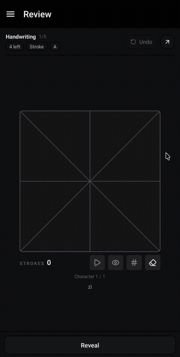
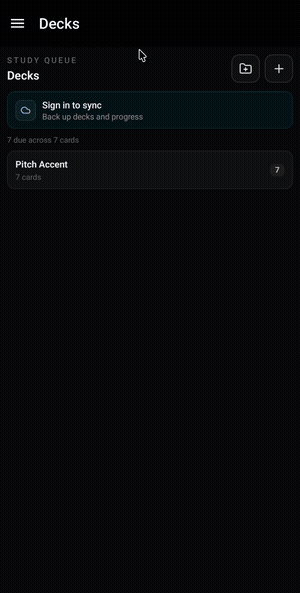

# Remlang

An offline-first study app for Japanese and Chinese. It bundles a full dictionary with pitch-accent diagrams, kanji and hanzi breakdowns and stroke-order practice, and schedules review with FSRS. It runs on Expo and SQLite, and works without a network connection.

<p align="center">
  
  &nbsp;&nbsp;
  
</p>

## What it does

- **Dictionary.** Search 338k entries (JMdict and CC-CEDICT) in English, kana, pinyin or characters, using a SQLite FTS5 index ranked by word frequency (TUBELEX for Japanese, wordfreq for Chinese). Word pages show senses, example sentences (Tatoeba), pitch accent (UniDic, with Kanjium as fallback) and character breakdowns (KRADFILE/RADKFILE and Wikimedia CCD).
- **Characters.** Animated stroke order from about 13,800 AnimCJK kanji and hanzi SVGs. You can practise by drawing on a Skia canvas, and each stroke is checked against the reference path as you draw it.
- **Decks and review.** Decks, folders, trash and linked decks: one primary deck mirrored into front-to-back, back-to-front, pitch and stroke review. FSRS scheduling (`ts-fsrs`) with daily limits, undo and statistics.
- **Optional cloud sync.** Sign in with Clerk to back up and sync decks and review history through a small Bun + Hono + Postgres API in [`backend/`](backend/). Without a Clerk key the app is fully offline.

## Engineering highlights

1. **A reproducible content pipeline.** [`scripts/seed/`](scripts/seed/) builds the ~970 MB dictionary database from about 30 pinned upstream files. Every language implements the same [`LanguageSeeder`](scripts/seed/core/types.ts) stages (prepare, extract, validate, transform, load, post-process) and writes into a shared multilingual schema with per-language extension tables. [`pnpm fetch:resources`](scripts/fetch-resources.ts) downloads each input at a pinned version (release tag, commit SHA or versioned archive) and checks it against a SHA-256 in [`scripts/data/sources.ts`](scripts/data/sources.ts), so every build starts from byte-identical inputs.
2. **Pitch-accent import.** [`pitchAccent.ts`](scripts/seed/languages/ja/pitchAccent.ts) matches UniDic lexemes to JMdict entries by lemma, so that homographs and proper nouns don't pick up the wrong accent. Kanjium fills the gaps. A separate audit tool ([`scripts/lib/ojadPitchAudit.ts`](scripts/lib/ojadPitchAudit.ts)) spot-checks the results against OJAD, and the matching rules are covered by regression tests.
3. **Stroke validation.** [`lib/drawing/validation.ts`](lib/drawing/validation.ts) samples each AnimCJK stroke path as Bézier curves. It then scores the user's stroke on direction, distance and start/end position, so handwriting review grades shape and stroke order rather than pixels.
4. **Local-first sync.** SQLite on the device is the source of truth. [`lib/sync/`](lib/sync/) pushes changed-row snapshots and pulls rows past a server cursor. It strips echoes of its own writes, asks the user how to resolve conflicts, and syncs deletions as tombstones so they win across devices. The backend side is [`backend/src/sync/service.ts`](backend/src/sync/service.ts).

## Architecture

```
app/            expo-router screens (dictionary, character, decks, review, knowledge, stats, settings)
components/     UI, review cards, Skia stroke canvas
lib/            database (Drizzle schema, search), store/ (decks, review, knowledge), review/ (FSRS),
                sync/, drawing/, auth/ (optional Clerk)
scripts/        content pipeline: fetch-resources, seed/, pitch-accent QA, fetch-db/pack-db
drizzle/        SQLite migrations, applied on device at startup
backend/        sync API: Bun, Hono, Drizzle, Postgres, Clerk
plugins/        Expo config plugin (Android build settings for the bundled DB)
```

The database ships inside the app as an asset and is copied into the app's data directory on first launch. From then on Drizzle migrations bring its schema up to date. See [ARCHITECTURE.md](ARCHITECTURE.md) for the data flow and the main design decisions.

## How it's built

I built Remlang on my own, working with AI coding agents throughout. Larger features started as a written design spec ([`docs/design/`](docs/design/)), an agent implemented them, and I reviewed the result against typecheck and the test suites. Choosing data sources, the licensing review, and deciding what the app should and shouldn't do were my calls.

## Getting started

**Prerequisites:** Node 22.15+ (24 recommended), pnpm 10 (`corepack enable`), plus Android Studio or Xcode for a development build. Expo Go isn't supported because the app uses custom native modules (Skia, SQLite FTS5 build flags, Clerk). Building the database from source also needs `tar` and `xz` (`brew install xz` on macOS). The backend and its tests need [Bun](https://bun.sh).

```bash
pnpm install

# Get the dictionary database (pick one)
pnpm fetch:db                          # prebuilt release: ~180 MB download
pnpm fetch:resources && pnpm seed      # build from source: ~330 MB download, ~2 min, ~4 GB RAM

pnpm android                           # or: pnpm ios
```

**Checks:** `pnpm typecheck`, `pnpm lint` and `pnpm test` (runs the `node:test` suites, then the backend's `bun test`).

## Configuration

Nothing is required: with no environment set, the app runs fully offline (no accounts, sync or premade decks). Copy [`.env.example`](.env.example) to `.env` to set any of these:

| Variable | Used by | Purpose |
|---|---|---|
| `EXPO_PUBLIC_CLERK_PUBLISHABLE_KEY` | app | Turns on accounts (Clerk) and with them cloud sync and premade decks |
| `EXPO_PUBLIC_SYNC_API_URL` | app | Base URL of the sync API, e.g. `http://localhost:8787` |
| `APP_ID` | [`app.config.ts`](app.config.ts) | iOS bundle identifier and Android package |
| `EXPO_OWNER` | `app.config.ts` | Expo account that owns the EAS project |
| `EAS_PROJECT_ID` | `app.config.ts` | Your EAS project; enables EAS Build and EAS Update when set |

For EAS builds, the profiles in [`eas.json`](eas.json) read their variables from EAS environments (`development`, `preview`, `production`), so set the `EXPO_PUBLIC_*` values there, for example `eas env:create --environment production --name EXPO_PUBLIC_SYNC_API_URL --value https://… --visibility plaintext`. Export `APP_ID`, `EXPO_OWNER` and `EAS_PROJECT_ID` in your shell before running `eas build`, since `app.config.ts` is evaluated locally.

To run the sync API locally (needs Postgres):

```bash
cd backend && cp .env.example .env && bun install && bun run db:push && bun run dev
```

The backend's variables are documented in [backend/README.md](backend/README.md). Premade decks are only served to signed-in users, and `PREMADE_DECK_USER_IDS` can limit them to specific accounts.

## Status

This is a personal project, most actively developed in March and April 2026. Android is the platform I use day to day. iOS builds from `expo prebuild` but hasn't been tested recently. There is no web build: the web target exists but doesn't load the database. The Chinese web edition of Remlang lives in a separate repository.

## License

The code is licensed under [AGPL-3.0-or-later](LICENSE). The AGPL's network clause covers the sync backend: if you run a modified version as a service, you must offer its source to its users.

The dictionary database and the data it's built from keep their own licenses, mostly CC BY-SA 4.0, so the prebuilt database is released under CC BY-SA 4.0 ([DATA-LICENSE.md](DATA-LICENSE.md)). [THIRD_PARTY.md](THIRD_PARTY.md) has the full attribution list, and the same list is shown on the in-app About screen.
